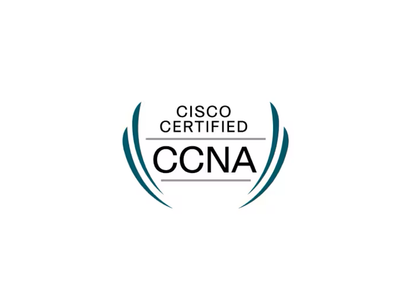

  

 

# 🐧 $ whoami

My name is **Fahad Mutlaq Alharbi**. I hold a **Bachelor of Science in Information Technology** and focus on **cloud infrastructure, network engineering, and DevSecOps**. I'm **CCNA certified** and currently building hands-on labs in **Linux (RHCSA), AWS, and Terraform**, with a goal of working in cloud infrastructure and DevOps. ☁️

  > Complexity is the ultimate enemy of security. If a core architecture configuration isn't automated, version-controlled, and continuously monitored, it cannot be truly secured.

---

### 🛠️ Technologies and tools

* 💻 **Operating Systems & Setup**  
   

* 🌐 **Networking, Routing & Automation**  
      

* ⚙️ **Web Servers & Services**  
     

* 📊 **Monitoring & Observability**  
   

* ⛓️ **Version Control**  
   

---

### 📖 What I am currently learning / improving on

* 🐧 **Linux Administration (RHCSA Preparation)**  
  

* ☁️ **Cloud Computing & Advanced Networking Core**  
    

* 🏗️ **Infrastructure as Code**  
  

* 🐳 **Containerization & Web Server Infrastructure (3-Week Deep Dive)**  
   

---

### 👾 What I am interested in learning at some point

* 🚀 **DevSecOps & CI/CD**  
   

---

### 📂 Featured Projects

<table width="100%">
  <tr>
    <td width="50%" valign="top">
      <a href="https://github.com/Fahad-Mutlaq/XAI-Diabetes-Prediction"><strong>XAI-Diabetes-Prediction</strong></a> 
      Explainable ML framework (XGBoost + SHAP) for diabetes prediction.
    </td>
    <td width="50%" valign="top">
      <a href="https://github.com/Fahad-Mutlaq/CCNA-Python-Lab"> <strong>CCNA-Python-Lab</strong></a> 
      Python/Netmiko network automation lab on GNS3: JSON-driven VLAN configuration across multiple switches.
    </td>
  </tr>
</table>

---

### 📜 Verified Certifications & Progress Roadmap

<table width="100%">
  <tr>
    <td width="50%" align="center" valign="middle" style="border: 1px solid #30363d; padding: 15px; border-radius: 6px; background-color: #0d1117;">
      <strong>🏆 Achieved Certifications</strong>
      

       
      

        
          
        <strong>Cisco Certified Network Associate (CCNA)</strong> 
        Nov 2026 - Nov 2029
      

    </td>
    <td width="50%" valign="top" style="border: 1px solid #30363d; padding: 15px; border-radius: 6px; background-color: #0d1117;">
      <strong>⚡ In-Progress Roadmap</strong>
      

       
      📌 <strong>AWS Solutions Architect (SAA-C03)</strong>  
        
      📌 <strong>HashiCorp Certified: Terraform Associate (004)</strong>  
        
      📌 <strong>Red Hat Certified System Administrator (RHCSA)</strong>  
    </td>
  </tr>
</table>

---

### 📮 Where to find me

 
